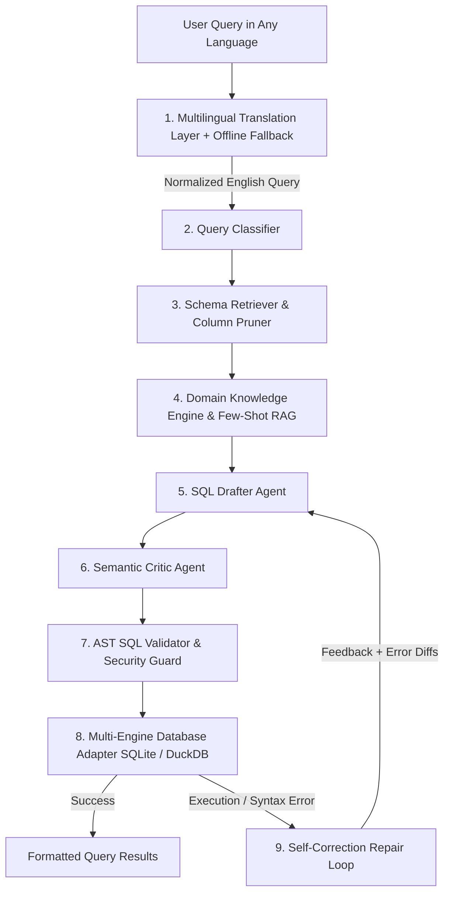

# NLPSQL System Features & Capabilities Report

NLPSQL is a Text-to-SQL project built around a small local model. It wraps generation in schema retrieval, a SQL validator, read-only execution, a repair loop and an access-control layer. This file describes what each part does; accuracy claims live only in the held-out benchmark (section 10), which you should run yourself.

---

## Architecture Overview



---

## 1. Multilingual Translation Layer

Non-English questions are translated to English before retrieval and generation ([`core/translator.py`](core/translator.py)):

- **English fast path**: an ASCII/keyword heuristic (`is_likely_english`) skips translation for obvious English.
- **Offline fallback**: a small rule-based dictionary (mostly Spanish, with a few other languages) covers common database words. It is a convenience, not a translator.
- **Online translation is opt-in.** Set `NLPSQL_ONLINE_TRANSLATION=1` to send non-English questions to `api.mymemory.translated.net`. Left unset, no question text leaves the machine. Anything sent includes the question text, which may contain business data.
- Results are cached in memory (`lru_cache`), and the dashboard shows when a question was translated.

---

## 2. Multi-Agent Reasoning & Generation Pipeline

NLPSQL breaks query generation down into specialized, modular agent components:

| Component | File | Function |
|---|---|---|
| **Query Classifier** | [`core/agents/classifier.py`](core/agents/classifier.py) | Analyzes complexity (`EASY`, `MEDIUM`, `COMPLEX`), extracts required operations (Aggregations, Group By, Joins, Window functions, Sorting), and detects candidate entities. |
| **SQL Drafter** | [`core/agents/drafter.py`](core/agents/drafter.py) | Dynamically chooses between native clean chat templates (for simple single-table queries) and grounded few-shot prompt assemblies for complex multi-table joins. |
| **Semantic Critic** | [`core/agents/critic.py`](core/agents/critic.py) | Pre-execution heuristic auditor. Catches missing `JOIN` conditions, case sensitivity traps (`LIKE` vs `=`), unaggregated columns in `GROUP BY`, and column collisions. |
| **Self-Correction Repair Loop** | [`core/pipeline.py`](core/pipeline.py) | If a query fails validation or database execution, captures dialect-specific error messages and re-prompts the Drafter with repair hints up to `max_repairs` times. |

---

## 3. Dynamic Schema Retrieval & Column Pruning (RAG for Schemas)

When databases scale to dozens or hundreds of tables, passing the whole DDL exhausts context windows and degrades accuracy ([`core/retriever.py`](core/retriever.py)):

- **Token & Keyword Overlap Ranking**: Scores tables based on query terminology match.
- **Foreign Key Graph Expansion**: Automatically includes join-dependency tables even if their names weren't explicitly stated in the user query.
- **Smart Column Pruning**: Retains up to 25 columns per table to avoid column-pruning hallucinations while strictly preserving primary and foreign keys.

---

## 4. Domain Knowledge Engine & Few-Shot In-Context Learning

- **Domain Knowledge Engine** ([`core/knowledge.py`](core/knowledge.py)):
  - Resolves business jargon and metrics (e.g., *"high earners"*, *"recent sales"*, *"remote employees"*, *"active projects"*).
  - Supplies column synonym mappings and value normalization rules directly into the prompt.
  - **Scoped Literal Matching**: Uses `allowed_tables` filtering so knowledge hints don't trigger false joins on unrelated tables.
- **Few-Shot Demonstration Retriever** ([`core/few_shot.py`](core/few_shot.py)):
  - Matches user queries against curated question-to-SQL pairs using TF-IDF cosine similarity.
  - Dynamically injects the most relevant few-shot exemplars to guide edge-case SQL syntax.

---

## 5. Multi-Backend Database Adapters

NLPSQL abstracts storage through a unified database adapter interface ([`core/adapters/base.py`](core/adapters/base.py)):

- **SQLite Adapter** ([`core/adapters/sqlite.py`](core/adapters/sqlite.py)):
  - Supports both in-memory databases and physical `.db` / `.sqlite` files on disk.
  - Enforces read-only query execution via connection PRAGMAs.
  - Supports virtual generated columns (`department TEXT GENERATED ALWAYS AS (name) VIRTUAL`) for seamless column aliasing.
- **DuckDB Adapter** ([`core/adapters/duckdb.py`](core/adapters/duckdb.py)):
  - Analytical engine capable of querying Parquet, CSV, and high-throughput columnar datasets.
  - Read-only execution safety guarantees.

---

## 6. Multi-Provider LLM & Cascading Architecture

Flexible provider abstraction ([`core/providers/base.py`](core/providers/base.py)) allows seamless switching between local models and cloud endpoints:

| Provider | File | Description |
|---|---|---|
| **Local GGUF (`SQLGenerator`)** | [`core/generator.py`](core/generator.py) | Embedded `llama-cpp-python` runtime running quantized local models (`SmolLM2-135M-text-to-sql.Q8_0.gguf`) with zero external API dependencies or GPU requirements. Implements `generate_text()`. |
| **Ollama Provider** | [`core/providers/ollama.py`](core/providers/ollama.py) | Connects to local or remote Ollama servers (`qwen2.5-coder`, `mistral`, `llama3`). |
| **OpenAI-Compatible API** | [`core/providers/api.py`](core/providers/api.py) | Connects to standard OpenAI endpoints, Groq, DeepSeek, or vLLM deployments. |
| **Cascading Provider** | [`core/providers/cascade.py`](core/providers/cascade.py) | Cost/latency optimizer: routes simple queries to fast, lightweight local models, automatically escalating complex queries or repair failures to frontier models. |
| **Mock Provider & Generator** | [`core/providers/mock.py`](core/providers/mock.py) | Instant offline testing, CI/CD pipelines, and automated test runners. |

---

## 7. Preloaded Multi-Domain Schemas

NLPSQL includes 4 production-grade relational database schemas with mock data ([`data/`](data)):

1. **Company Database (`company.sql`)**: Employees, departments (with virtual column aliasing), projects, sales, performance ratings, leaves.
2. **E-Commerce Database (`ecommerce.sql`)**: Customers, orders, items, products, categories, reviews, payments.
3. **Healthcare Database (`healthcare.sql`)**: Patients, doctors, appointments, medical records, prescriptions, billing.
4. **University Database (`university.sql`)**: Students, instructors, courses, sections, enrollments, departments, grades.

---

## 8. Schema Importer: Upload & Query Custom Data

Users can dynamically import external data and immediately query it in natural language via [`core/schema_importer.py`](core/schema_importer.py):

| Upload Format | Processing Pipeline |
|---|---|
| **`.sql`** | Direct schema ingestion — parses `CREATE TABLE` DDL and `INSERT` data seed statements. |
| **`.csv`** | Auto-infers table names from filename; dynamically detects column types (`INTEGER`, `REAL`, `TEXT`) and creates matching relational tables with loaded rows. |
| **`.json`** | Ingests flat JSON arrays or multi-table dictionary structures (`{"table_a": [...], "table_b": [...]}`). |
| **`.pdf`** | Extracts embedded text via `pdfplumber`; parses `CREATE TABLE` blocks or automatically converts visual table grids into relational tables. |

---

## 9. Security: Validator and Access Control

**Validator** ([`core/validator.py`](core/validator.py)), built on SQLGlot:
- Exactly one statement, and it must be a query. Writes, DDL, `PRAGMA`, `ATTACH`, `COPY` and `INSTALL` are rejected.
- Tables and columns must exist in the schema, including qualified columns (`e.salary` is checked against `e`'s table).
- Recursive CTEs are rejected, as are queries with more than one join lacking a join condition (cartesian blow-ups).
- A deny-list blocks file-access and sleep functions (`load_extension`, `pg_read_file`, `pg_sleep`, `sleep`, ...). A deny-list is a backstop, not a sandbox.

**Execution**: adapters open the database read-only, cap returned rows (`LIMIT 100` by default) and enforce a timeout (SQLite progress handler, DuckDB interrupt).

**Access control** ([`core/security.py`](core/security.py)): per-role table/column allow-lists, mandatory row filters, masked columns and an audit log. A CTE that reuses the name of a real table is rejected, because the engine would resolve the inner reference to the real table and skip the role's row filter. Regression tests for this are in `tests/test_rbac_regressions.py`, run on SQLite and DuckDB, and `core/security_redteam.py` exercises the same cases.

Feedback is isolated by role and schema; legacy unscoped rows migrate to the `local_operator` role. The HTTP server uses a thread per request, while model generation through the shared pipeline is serialized. Treat the access layer as defence in depth and put real permissions on the database account too.

---

## 10. Evaluation

The old 5-question benchmark (`run_benchmark.py`) used questions that were also in the few-shot examples, so its 100% was not evidence of accuracy. It is kept only as a smoke test.

The real benchmark is `eval/heldout_benchmark.json`: 80 questions with gold SQL across the four bundled schemas (20 each, easy/medium/hard). Guards:
- `check_leakage` fails the run if a question or its gold SQL matches a few-shot example, or a question appears in the semantic-layer YAML. Near-duplicates (TF-IDF similarity >= 0.8) are reported as warnings.
- Benchmark pipelines are built with `include_feedback=False`, so feedback saved from the dashboard cannot leak in.
- Every gold query is checked to be valid, to return rows, and to have no tie at its `LIMIT` cutoff (`tests/test_heldout_benchmark.py`).

```bash
python run_heldout_benchmark.py --out results.json --markdown results.md
```

It reports execution accuracy with a 95% Wilson interval, valid-SQL rate, coverage and selective accuracy under abstention, a confidence-vs-accuracy table, and ablations that each disable one component (repair, few-shot, semantic layer, schema pruning, value linking, confidence sampling) plus a minimal baseline. The runner refuses to run with the mock provider.

Limits to keep in mind: the bundled databases are tiny, so execution match is weaker evidence than on Spider or BIRD, and 80 questions give wide intervals. Differences of a few points are noise. Publish the numbers from your own run, not these descriptions.

---

## 11. Interactive Web Dashboard

A responsive web application served via Python standard library in [`app.py`](app.py):
- **Live Schema Explorer**: Interactive schema drawer displaying tables, columns, data types, and primary/foreign key relations.
- **Schema Switcher**: Seamless switching between preloaded databases (Company, E-Commerce, Healthcare, University) and user-uploaded custom schemas.
- **Schema Upload Modal**: Drag-and-drop file upload supporting `.sql`, `.csv`, `.json`, and `.pdf` files.
- **Multilingual Query Support**: Accepts queries in any language with live visual indicator (`🌐 Translated to English: "..."`).
- **Context-Aware Query Suggestions**: Quick-query clickable pills tailored to the active database.
- **Telemetry & Results Display**: Real-time stats (inference time, query execution time, attempt counter), formatted SQL box with copy button, and an interactive data table with row counters.
